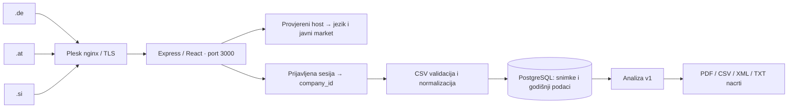

# Arhitektura i sljedeći razvoj

## Implementirana osnova

Lokalni demo koristi memorijsko spremište i sintetičke podatke. Baza koristi UUID identitete, vremenski određene sesije, složeni tenant FK na snimci i zaposleniku i jedinstven pseudonim po snimci. Novi uvoz stvara novu snimku; čitanje vraća posljednju za odabranu godinu. Trenutni javni UI ne prikazuje povijesni pregled snimki.

Javni host nije sigurnosna granica tenanta. Svaki zahtjev za podacima koristi `company_id` iz provjerene sesije. Host mora biti u eksplicitnom allowlistu. Promjena `.de` u `.si` ne daje pristup slovenskoj tvrtki. Alias cookie je host-specific; prijava preko druge domene zahtijeva novu sesiju.

Korisničke lozinke koriste scrypt i nasumičnu sol. Sesijski token je HttpOnly/SameSite=Strict cookie i u bazi se čuva njegov SHA-256 sažetak. U produkciji je cookie Secure. Mutacije zahtijevaju točan Origin. API koristi no-store, ograničenje veličine i rate limiting; ključevi i payroll se ne zapisuju u logove.

HMAC secret mora ostati stabilan za kontinuitet pseudonima. Rotacija zahtijeva plan migracije. Polje `anonymized_id` zadržava naziv iz početnog zadatka, ali predstavlja **pseudonim**, ne dokaz GDPR anonimizacije.

## HRIS ugovor

Factory u [server/hris.js](../server/hris.js) ima registry i bazni interfejs:

- `testConnection()` — dostupnost i scopes.
- `fetchEmployees()` — organizacijski podaci.
- `fetchPayrollPeriods()` — stvarne povijesne isplate i sati.

Svaki adapter treba još implementirati autentikaciju specifičnu za sustav (OAuth, servisni račun, client id/secret, certifikat ili API ključ), paginaciju, timeoute, rate-limit backoff i endpoint allowlist. Svaka veza je per-tenant. Ne prihvaćati proizvoljan tenant URL bez SSRF zaštite. U ovom MVP-u nema ruta za pohranu ključeva jer nema aktivnih konektora.

Odabir sustava koji API ne daje godišnje bonuse/povijest nije potpuna integracija za izvještavanje. Personio/HiBob mogu biti početni kandidati uz stvarne klijentske potrebe. DATEV, BMD, PANTHEON i Minimax su kandidati za istraživanje lokalnog payrolla; njihova prisutnost u katalogu nije tvrdnja da imaju otvoren odgovarajući API. Nije zaprimljena izvorna slika pa katalog pokriva imenovane sustave, a ne verificiranu cjelokupnu listu sa slike.

Agregator ubrzava katalog samo ako pokriva potrebna polja i razdoblja. Procijeniti cijenu po povezanoj tvrtki, EU lokaciju podataka, podizvršitelje, DPA, historijski payroll i ograničenja API-ja prije izbora. Figuresova unutarnja arhitektura nije poznata.

## Nedovršeno za komercijalni proizvod

| Područje | Potrebna implementacija / dokaz |
| --- | --- |
| Metodologija | Tretman naknada/pogodnosti, stvarni sati, izostanci, početak/kraj rada, headcount, evaluacija rada jednake vrijednosti i spol |
| PostgreSQL | Migracija i API test na stvarnoj bazi, restart/persistencija, paralelni uvozi i tenant negativni testovi |
| Konektori | Verificirani adapteri, testne tvrtke, background sync, zaključavanje poslova i revokacija pristupa |
| Državni export | Službeni izvori i verzije shema, validacija i prihvaćen testni izvoz za svaki kanal |
| Workflow | Obrazloženja jaza, plan i simulacija korekcije, šestomjesečni rok, potvrda uprave i konzultacija predstavnika radnika |
| Pravo na informacije | Evidencija zahtjeva, rok od dva mjeseca, privatnost malih skupina i lokalizirana odobrena pisma |
| Identitet | MFA, email verifikacija, oporavak računa, pozivnice i granularna prava po ulozi; rate-limit iza provjerenog proxyja |
| Komercijala | Billing, planovi, ugovori, DPA, podrška i partnerski pristup |
| Operacije | Backup izvan VPS-a, uspješan restore, monitoring, alerti, patching, retention/brisanje/izvoz podataka |
| Sigurnost | Neovisna provjera tenanta i API-ja, šifriranje integracijskih tajni, hardening i pregled podizvršitelja |
| UI | Povijest snimki, stvarne oznake/kategorije po tenant-u, vremensko uspoređivanje i hrvatski nije ciljni produktni jezik |

Za jedan VPS odabrati jednostavnost: jedan Node proces za web, PostgreSQL na privatnom socketu/adresi, a pri dodavanju sinkronizacije zaseban worker s PostgreSQL redom poslova. Redis nije potreban za ovu početnu verziju. Jedan VPS ostaje jedna točka otkaza; dokumentirati stvarne RPO/RTO i testirati obnovu prije ugovorne dostupnosti.

DEV 1: metodologija, stvarna baza, nacionalni adapteri i export validacija. DEV 2: provider autentikacija, povijesni payroll, tajne i worker. DEV 3: onboarding, klasifikacija, zahtjevi zaposlenika, izvještaji i lokalizacija. Ovo je podjela razvoja, ne tvrdnja da je svih tih područja MVP već dovršio.
