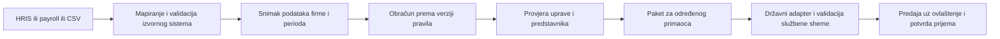

# Equitensa: zajednički podaci, verzionirana pravila i nacionalni izvoz

Provjera izvora: 1.11.2026. Ovaj dokument ispravlja tvrdnje da je kombinacija DE XHTML / AT CSV / SI ISPAP XML automatski dovoljna za prijavu privatnih poslodavaca po Direktivi (EU) 2023/970. Nisu potvrđeni nacionalni kanali ni službene sheme novog izvještaja za sva tri tržišta.

## Šta službeni izvori potvrđuju

| Izvor | Potvrđeno | Šta iz toga ne proizlazi |
| --- | --- | --- |
| [Direktiva 2023/970, članovi 3, 4, 9, 10, 12 i 29](https://eur-lex.europa.eu/legal-content/EN/TXT/?uri=CELEX:32023L0970) | Sedam grupa pokazatelja a–g; godišnji bruto i odgovarajući bruto satni iznosi; potvrda uprave nakon konsultacija s predstavnicima; nacionalno tijelo prikuplja podatke. | Direktiva ne određuje jedan EU XML/XSD, ISPAP ili obavezni Bundesanzeiger XHTML. |
| [AJPES: Plače v javnem sektorju / ISPAP](https://www.ajpes.si/Statistike/Place_v_javnem_sektorju/Splosno) | ISPAP prikuplja plaće, druga izplačila i broj zaposlenih javnog sektora. Obveznici su proračunski korisnici pod ZSTSPJS. Predaja je XML uz odgovarajuća prava i kvalificirano digitalno potpisivanje. | Postojanje ovog XML-a nije potvrda da privatna slovenska firma njime predaje Article 9 izvještaj. |
| [Njemačka EntgTranspG §21](https://www.gesetze-im-internet.de/entgtranspg/__21.html) i [§22](https://www.gesetze-im-internet.de/entgtranspg/__22.html) | Postojeći Bericht zur Gleichstellung und Entgeltgleichheit za poslodavce s u pravilu više od 500 zaposlenih, koji moraju sastaviti Lagebericht; prilog Lageberichtu objavljuje se u Unternehmensregisteru. | Nije identičan novom Article 9 izvještaju za 150+ zaposlenih. Prihvaćanje XHTML/XBRL za finansijski izvještaj ne potvrđuje novu shemu za rodni jaz. |
| [Austrija GlBG §11a](https://www.ris.bka.gv.at/NormDokument.wxe?Abfrage=Bundesnormen&Gesetzesnummer=20003395&Paragraf=11a) | Postojeći dvogodišnji Einkommensbericht: spol, kolektivne/interne grupe i dostupne godine u grupi, prosjek ili medijan, normalizacija nepunog vremena i dijela godine, anonimnost, dostavljanje predstavnicima odnosno dostupnost radnicima. | Ovaj propis ne potvrđuje obavezni CSV/XML za Arbeitsinspektorat niti službenu ovjeru PDF-a kontrolnim zbrojem. |

Kontrolni zbroj dokazuje integritet samo u odnosu na pouzdano zabilježenu referentnu vrijednost. Ne predstavlja državno odobrenje ni kvalificirani elektronski potpis.

## Obaveze EU i primaoci

Član 9(1) traži:

1. Ukupni rodni jaz u plaćama.
2. Jaz u dopunskim ili varijabilnim komponentama.
3. Medijan ukupnog jaza.
4. Medijan jaza u dopunskim/varijabilnim komponentama.
5. Udio muškaraca i žena koji primaju te komponente.
6. Udio muškaraca i žena u svakom platnom kvartilu.
7. Jaz po kategorijama istog ili jednakovrijednog rada, odvojeno osnovna i dopunska/varijabilna naknada.

Podaci a–g dostavljaju se tijelu iz člana 29(3)(c), koje prikuplja podatke i objavljuje a–f. Poslodavac može objaviti a–f. Radnici i njihovi predstavnici dobivaju g; inspekcija rada i tijelo za jednakost dobivaju ih na zahtjev. Unutrašnje obrazloženje/metodologija i pojedinačni platni podaci nisu automatski dio javnog paketa.

EU minimum: 250+ zaposlenih prvi put 7.6.2027. za 2026, zatim godišnje; 150–249 isti prvi rok, zatim svake tri godine; 100–149 prvi put 7.6.2031. Nacionalni zakon može proširiti obuhvat i učestalost. Rok za prenošenje direktive bio je 7.6.2026; to nije datum prvog izvještaja niti datum njenog stupanja na snagu.

Za zajedničku procjenu člana 10 nisu dovoljni samo prag od 5% ili automatski alarm. Sva tri uvjeta su kumulativna: jaz najmanje 5% po kategoriji, nedostatak objektivnog rodno neutralnog opravdanja i neotklanjanje u šest mjeseci od stvarne predaje izvještaja.

## Arhitektura koju trebamo

Unos je zajednički, ali mora sačuvati izvor, period, valutu, učestalost isplate, bruto osnovicu, sve dopunske/varijabilne komponente, relevantne nenovčane beneficije, radno vrijeme, trajanje zaposlenja i kriterije jednakovrijednog rada. Pretvaranje svega u samo jednu FTE satnicu gubi podatke potrebne za a–g.

Lokalne vrijednosti spola mapiraju se po dokumentiranom izvornom sistemu: M/männlich/moški → M; F/W/weiblich/Ž/ženska → F. Ne prepoznate ili dvosmislene vrijednosti traže potvrdu, nikada se ne pretpostavljaju. `Gehalt` ili `Plača` nisu dovoljni za automatsko zaključivanje je li iznos mjesečni/godišnji ili bruto/neto. Austrijska 13. i 14. isplata moraju ostati obuhvaćene godišnjim bruto iznosima.

Formula sa 40 i 173,33 može biti dodatna poslovna normalizacija; nije univerzalna službena formula EU niti je ovim istraživanjem potvrđena kao obavezni Figures obračun. Član 3 i uvodna izjava 22 traže godišnju bruto plaću i odgovarajuću bruto satnu plaću. Nacionalna metodologija treba potvrditi nazivnik sati, obuhvat i normalizaciju odsustava/dijela godine. Poređenje jednakovrijednog rada zahtijeva rodno neutralne kriterije vještina, napora, odgovornosti i uvjeta rada, ne samo jednak naziv pozicije ili KV šifru.

Obračunski modul treba zajedničke funkcije plus verzionirana pravila po državi, sektoru i pravnoj obavezi. Izvozni adapter nije samo drugačija ekstenzija istog fajla: ima zahtijevana polja, šifrarnike, period, obuhvat, primaoca, format i eventualno ovlaštenje/potpis.

Država adaptera dolazi iz autentificirane firme/pravnog subjekta. Domena `.de/.at/.si` bira jezik i tržišni prikaz; promjenom domene ne smije se promijeniti zakonska država izvještaja. Grupa firmi sa subjektima u više država treba odvojene profile i obaveze, ne jedan slučajni odabir prema Host zaglavlju.

Prije službenog adaptera evidentirati: objavljeni zakon i član, vrstu izvještaja, obveznike, nadležno tijelo, portal, službenu shemu i verziju, primjere, validaciju, način autentifikacije/potpisa i dokaz uspješne testne predaje. Za XBRL trebaju službena taksonomija i konteksti; proizvoljni XML s ekstenzijom XBRL nije dovoljan.

## Trenutni kod i preostali posao

Postojeći [normalizator i obračun](../server/pay.js) čuvaju godišnje/satne iznose i dodatnu FTE satnicu. [Regulatorni plan](../server/regulatory.js) odvaja primaoce i označava državne kanale kao nepotvrđene. [Izvozi](../server/reports.js) generiraju radni PDF/CSV/XML/TXT, a ne potvrđenu službenu predaju. Direktni HRIS konektori još su planirani; trenutni aktivni unos je CSV.

Za službenu upotrebu još treba potvrditi nacionalne metodologije i sheme, dodati obuhvat svih komponenti naknade i potrebne podatke za lokalne normalizacije, završiti HRIS adaptere i zasebne postojeće nacionalne izvještaje te testirati predaju. Zaštićene male grupe treba obrađivati prema primaocu i nacionalnim pravilima: član 12(3) izričito propisuje dostupnost podataka tijelu za praćenje bez ograničenja; ista automatska supresija za sve primaoce nije konačni službeni model.

Sadašnje interne potvrde i evidencija pripreme ne predstavljaju državni pečat. Učitavanje fajla, ovlašteno slanje, digitalni potpis i potvrda prijema zasebni su koraci. Tek potvrda državnog sistema opravdava status **Predano**, dok naš izvoz može imati status **Pripremljeno / Preuzeto**.
